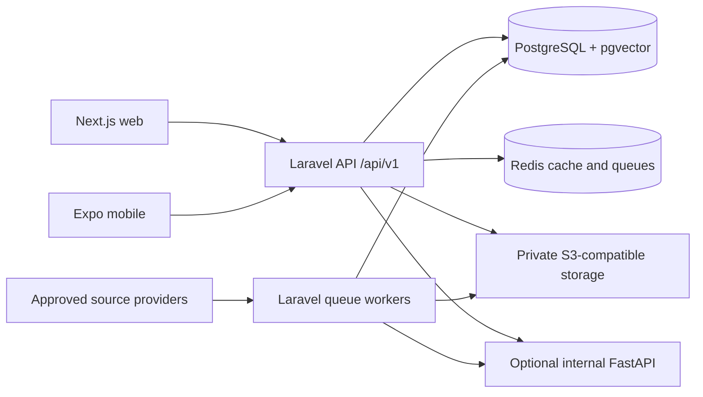

# Target architecture

Status: design, not an inventory of deployed services. See [README](../../README.md) for the scaffold state and [DECISIONS](DECISIONS.md) for rationale.

## Topology

Laravel is a modular monolith, with web API processes, scheduled ingestion and queue workers sharing canonical domain code. These are deployment roles, not independent business services. Avoid separate journal, account or project microservices without measured operational need.

## Component responsibilities

| Component | Exists to | Must not own |
| --- | --- | --- |
| Laravel | Validate requests, enforce authorization/entitlements, own catalog and personal records, orchestrate ingestion/ranking/jobs, publish API responses | Python-specific extraction implementations |
| Next.js | Render web journeys, localization, accessible forms, API consumption | Canonical ranking, billing rules, source resolution, direct database access |
| Expo | Deliver mobile presentation and platform UX with the same contract | Independent business logic or direct AI/database access |
| PostgreSQL + pgvector | Transactional canonical data, full-text retrieval and optional versioned vectors | Implicit authorization relying on client filters |
| Redis | Queue coordination, rate limits and disposable caches | Sole durable copy of journal facts or research records |
| S3-compatible storage | Private raw source artifacts where permitted and later manuscript objects | Public manuscript hosting |
| FastAPI | Optional embeddings, NLP, document extraction or RAG computation that benefits from Python | Public clients, canonical users/projects, policy decisions or independent business writes |
| Contracts package | Generated typed clients/models from reviewed OpenAPI | Hand-maintained competing API definitions |

Cloudflare R2 is a candidate object-store vendor; vendor, region, residency and lifecycle policies are pending. Storage remains provider-neutral.

## Domain modules

MVP V1 Laravel modules cover catalog/provenance, ingestion, discovery/recommendation, accounts/saves, lightweight projects and contextual journal assistance. Add files and manuscript analyses only after V1. Projects own metadata, selection/revision and the three-state workflow; the assistant consumes journal evidence without owning project policy. Domain modules communicate through application services and transactions. Start with existing Laravel structure; a new module framework is unnecessary.

Laravel owns canonical database writes and final eligibility/ranking. Python returns embeddings, similarity/features or extraction results tagged with model/input versions. Laravel validates and persists them. Initially pass bounded inputs/results through authenticated internal requests or jobs; do not grant FastAPI general database credentials. If later read-only vector access is necessary, document a narrow role and authorization boundary before changing this design.

## Request and ingestion flows

Discovery: client POSTs research input → Laravel validates and applies request limits → reads the eligible catalog → retrieves lexical/optional semantic candidates → enforces strict constraints → ranks with versioned configuration → returns bounded results and evidence. The catalog never calls providers synchronously during user discovery. Optional AI explanations can be omitted on timeout.

Ingestion: scheduler/authorized operator → provider adapter → staged source records → identity resolution and assertions → validation/review → transactional publication of a new journal revision → search/vector/cache refresh. Unreviewed staging never becomes a public fact automatically. Ingestion must be retryable, checkpointed and idempotent.

MVP project/workspace: authenticated client creates/edits a private project → Laravel validates ownership, minimum metadata and `discovery` → `journal_selected` → `preparation` → stores selection and requirements revision → returns project state and scoped journal evidence for Overview, Requirements, Fees and Template. Journal change clears/replaces the revision and transient assistant context. Authors are metadata, not access grants.

MVP assistant: authenticated question under a project → Laravel checks ownership and selected journal → retrieves verified stored facts and permitted authoritative journal passages for the applicable revision → returns deterministic cited answers or optionally validated generated wording. If evidence is unavailable/insufficient, explicitly return that the information could not be verified. No project abstract/authors are automatically sent to an AI provider; no manuscript retrieval or generic writing chat. See [RAG](../ai/RAG.md).

Post-MVP uploads: Laravel authorizes the project and prepares a private object key/upload grant → client uploads under bounded rules → completion is validated → quarantined processing → worker passes only authorized content to extraction → Laravel stores analysis/version metadata. Download grants are issued only after authorization.

## API and contract boundary

Foundation V1 implements `packages/contracts/openapi.yaml` using OpenAPI 3.1.0, with openapi-typescript declarations and Redocly-core validation. npm workspaces/root package-lock.json are canonical. Laravel implements the health/auth/me routes in [API](../api/API.md); the table below describes future domain endpoints alongside implemented me.

Domain endpoint proposals (not implemented except `/me`):

| Method/path | Purpose | Access/phase |
| --- | --- | --- |
| `POST /api/v1/discoveries` | Transient discovery input and ranked results | Public with limits; MVP |
| `GET /api/v1/journals` | Bounded catalog browsing/filtering | Public; MVP |
| `GET /api/v1/journals/{id}` | Journal profile with field evidence | Public; MVP |
| `GET /api/v1/me` | Current account | Authenticated; foundation |
| `GET/POST /api/v1/saved-searches` | List/create private saved inputs | Owner; MVP |
| `DELETE /api/v1/saved-searches/{id}` | Delete owned saved search | Owner; MVP |
| `GET/POST /api/v1/saved-journals` | List/create private bookmarks | Owner; MVP |
| `DELETE /api/v1/saved-journals/{id}` | Delete owned bookmark | Owner; MVP |
| `GET/POST /api/v1/projects` | List/create owned lightweight projects | Owner; MVP V1 |
| `GET/PATCH/DELETE /api/v1/projects/{id}` | Resume/edit/delete; validated status and journal selection | Owner; MVP V1 |
| `POST /api/v1/projects/{id}/assistant/questions` | Selected-journal question and cited answer/insufficiency result | Owner with selected journal; MVP V1 |

Project responses include metadata, selected journal/revision and evidence references. Workspace tabs reuse project and scoped journal resources; tab-specific services are unnecessary. Laravel resolves journal scope from the owned project, never from an unchecked client-supplied journal ID. A selection/revision change during processing must reject/discard an obsolete assistant answer. Q&A is transient by default; persisted conversations are not a V1 requirement. Endpoint shapes are proposals to finalize in OpenAPI, not implemented APIs.

Basic comparison can use bounded journal profile retrieval; add a comparison resource only if server behavior warrants it. Discovery POST avoids placing unpublished abstracts in query URLs. Do not persist anonymous request text beyond transient processing by default.

Foundation V1 implements register, SPA login/logout, device token issuance/current revocation and me. `/sanctum/csrf-cookie` is the documented CSRF framework exception outside `/api/v1`. `/api/user` is removed without a compatibility alias because no external consumer exists. Password-reset endpoints remain unimplemented. See [AUTHENTICATION](../api/AUTHENTICATION.md) for environment-driven first-party CORS/CSRF, HttpOnly sessions and expiring/revocable Bearer tokens.

Specify request validation, stable IDs, UTC timestamps, cursor/list bounds, error code/message/field details and correlation IDs. Never include stack traces or private input in errors. Discovery responses include criteria, algorithm/config/data revision, matches, warnings and field provenance. Async job statuses and idempotency behavior are added when required, not speculatively to every endpoint.

## Reliability and operations

Use bounded retries and provider-specific backoff; poison jobs enter a failed-job/review path. Unique work keys prevent duplicate publication. Database transactions cover canonical updates; after-commit jobs and repairable revision-based refreshes handle cache/vector consistency. External calls never hold long database transactions.

Cache public journal revisions only under predictable versioned keys. Do not place personal discovery text/results in shared caches. On FastAPI failure, return lexical results labeled with the actual ranking mode; the required journal assistant retains a deterministic verified-fact/passage answer path or reports an explicit unavailable result; on provider failure, keep previously valid catalog revisions and surface freshness warnings.

Run TLS at the public edge, keep database/Redis/AI private, separate environments and credentials, and collect sanitized request/job metrics. Back up database and eligible objects, validate restoration and define recovery objectives before production. No Kubernetes, event bus or additional vector database is required by this design.

## Current gaps

Foundation V1 provides PostgreSQL development/test instances, vector activation without business columns, versioned health/auth/me, safe errors/request IDs, Sanctum session/device token tests and OpenAPI generation. Database-backed sessions/cache and the existing queue configuration are interim defaults; Redis is not implemented in this phase. Phase 2 now implements the journal data/provenance schema, typed material facts and internal immutable journal/catalog revision primitives. Phase 3A implements provider-agnostic local ingestion with synthetic fixtures, PostgreSQL staging, dry-run, identifier resolution, explicit reviews and controlled revision publication; see [Phase 3A](../development/JOURNAL-INGESTION-V1.md). Journal public APIs, real-provider ingestion, recommendations, projects/workspace/assistant, AI, object storage, billing and client UI remain unimplemented. See [Phase 2](../development/JOURNAL-DATA-MODEL-V1.md). They retain their approved roadmap scope. See [Foundation verification](../development/FOUNDATION-V1.md).
