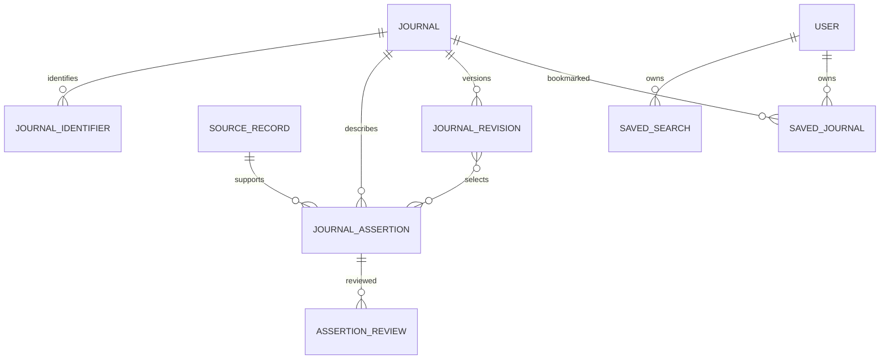

# Logical data model

Status: proposed relational design; no migrations are implemented. PostgreSQL is the canonical store. [JOURNAL-SCHEMA](JOURNAL-SCHEMA.md) defines field semantics; [DATA-SOURCES](DATA-SOURCES.md) defines evidence policy.

## MVP entities

| Entity | Key relationships | Purpose / constraints |
| --- | --- | --- |
| `users` | Own saved searches/journals | Existing scaffold entity; public IDs and future lifecycle policy require design |
| `publishers` | One publisher may relate to many journals | Sourced identity; publisher changes do not overwrite historical assertions |
| `journals` | Publisher reference; many identifiers/assertions/revisions | Stable opaque ID, lifecycle state, current published revision |
| `journal_identifiers` | Belong to journal | Scheme/value/provider; normalized ISSNs checked; duplicate ownership requires review |
| `disciplines` | Linked to journals with evidence | Versioned vocabulary and optional parent; no invented disciplinary assignment |
| `journal_disciplines` | Journal + discipline + assertion | Curated or attributed scope classification |
| `data_sources` | Many source records and ingestion runs | Provider authority/terms metadata; secrets kept elsewhere |
| `ingestion_runs` | Provider, many staged/source records | Status, checkpoint, counts, error codes, adapter version; no private text in errors |
| `source_records` | Provider/source key, ingestion run | Source URL, retrieved date, source date, hash and optional private artifact reference |
| `journal_assertions` | Journal + source record | Immutable typed field claim, original/normalized value, context, effective dates |
| `assertion_reviews` | Assertion, reviewer/method | Append verification/rejection/conflict decisions and review timestamps |
| `journal_revisions` | Journal, selected assertion references | Coherent published projection; immutable version and publication time |
| `journal_documents` | Journal + source record/assertion | Guideline/template/document URL, kind, language, version/hash and reuse permissions |
| `journal_requirements` | Journal revision + supporting assertions | Structured contextual rules, units and original wording |
| `journal_embeddings` | Journal revision + model version | Optional derived vector, language/input hash, dimensions and creation time |
| `recommendation_runs` | Optional owner; config + catalog revision | Minimal reproducibility metadata and ranked IDs; private text only if explicitly saved |
| `recommendation_matches` | Run + journal revision | Rank, relevance/features, warnings and evidence references |
| `saved_searches` | Owner + optional run | Explicitly saved private input/preferences and optional result revision references |
| `saved_journals` | Owner + journal | Unique owner/journal bookmark; deletion never deletes the public journal |
| `audit_events` | Actor + resource/action | Sanitized operational/security trail, no manuscript body or credentials |

Do not persist raw anonymous discovery input or a durable anonymous user profile by default. Recommendation-run operational metadata must be bounded by approved retention and must not allow reconstruction of research text. Authenticated transient discovery is also not automatic consent to save a search.

## Evidence versus projection

Source records describe observations. Assertions describe field claims. Reviews describe verification decisions. A published revision selects the assertions that back its values. Derived scope summaries, embeddings and relevance scores are stored separately from authoritative facts with their derivation versions.

Use structured relational records for identity, fees, languages, memberships, ownership and constraints. JSONB is appropriate for original provider payloads (when permitted), contextual assertion values and versioned feature diagnostics; it is not a substitute for foreign keys and indexed business relationships. Require typed validation for JSON assertion values.

Public availability states are `known`, `unknown`, `not_applicable` or `conflicted`; known values also carry verification/freshness state. Explicit verified zero is distinct from null. A conflict cannot yield a verified projection until resolved. Not-applicable requires context and evidence or a documented rule.

## Relationships and constraints

Use foreign keys, explicit lifecycle transitions, unique provider keys and owner/journal uniqueness. Stable opaque public IDs are recommended for new resources; decide UUID/ULID conventions during foundation without gratuitously changing existing user IDs. Public IDs do not replace authorization.

Money uses exact decimal values or validated minor units plus ISO currency; never floats. Store timestamps in UTC; preserve source timezone/date precision separately. Store original source units and wording alongside normalized requirements. Index identifiers, active revisions, discipline links, source keys and owner relationships. Add full-text and vector indexes only against representative query plans and chosen embedding dimensions.

## Future entities

| Entity group | Relationships / invariants |
| --- | --- |
| `projects`, `project_authors`, `project_shortlists` | Owner required; selected journal optional during discovery; author personal data stays private |
| `project_requirements_snapshots` | Immutable selection of journal revision and requirements; journal change invalidates old compliance applicability |
| `project_files`, `manuscript_versions` | Private object references, hash/type/size/status; versions tied to project and uploader |
| `analysis_runs`, `analysis_findings` | Manuscript version + requirements snapshot + analyzer version; findings cite rules and report unsupported checks |
| `assistant_conversations`, `assistant_messages` | Explicit retention and owner/project scope; citations refer to authorized evidence |
| `document_chunks`, `chunk_embeddings` | Document revision and scope; separate public journal and private project retrieval |
| `project_activity` | Safe workflow events, never full manuscript text |
| `institutions`, `memberships`, `project_access` | Later tenant model; design role and ownership migration before institution release |

Do not create these tables in the foundation merely because they appear in this roadmap.

## Lifecycle and deletion

Withdrawn/merged journals remain traceable via lifecycle state and successor references; saved historical results retain revision references. Only active eligible journals enter new recommendations. Source corrections append reviews/revisions rather than destroying evidence history.

User deletion cascades or schedules removal of private saved inputs and later files, derivatives and conversations. Public source facts are not deleted with a user account. Security audit retention uses minimized identifiers under the approved policy. Backups and provider-side deletion require a documented expiry/replay process; soft deletion alone does not satisfy a deletion request.
