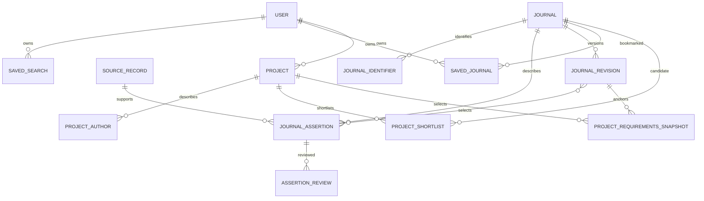

# Logical data model

Status: Phase 2 journal data/provenance schema is implemented in Laravel/PostgreSQL; personal MVP entities and later capabilities below remain planned. PostgreSQL is the canonical store. [JOURNAL-SCHEMA](JOURNAL-SCHEMA.md) defines field semantics; [DATA-SOURCES](DATA-SOURCES.md) defines evidence policy.

Phase 3A adds five relational ingestion tables: `ingestion_source_providers` (immutable one-provider-per-source binding), `ingestion_runs` (source, provider/mapping version, input hash and unique run key), `ingestion_items` (bounded immutable payload, normalized proposal, outcome, journal/source and publication receipt), `ingestion_run_items` (immutable ordered membership and prior-item reuse flag) and `ingestion_claims` (exact assertion links and claim hashes). Run and item IDs use UUIDv7. Runs support staged/failed/completed states and fixed sanitized interruption diagnostics; items can be failed and retried. Completion rejects unfinished items. Unique-item counters are derived from membership/current outcomes (seen, staged, quarantined, unchanged, failed), with no mutable counter columns. Stage membership and claims restrict deletion and cannot be rewritten. Item processing/review/publication reuse the Phase 2 catalog; staged data is not public verified data. See [Phase 3A](../development/JOURNAL-INGESTION-V1.md).

## Implemented Phase 2 catalog

The physical schema uses UUIDv7 (`HasUuids` in installed Laravel 13), retaining integer user/token IDs. Publishers/journals hold working identity records, not implicitly verified publication facts. `submission_url` is an evidenced scalar assertion, not a mutable journal column. Every language/type/subject/indexation/fee/requirement/template/identifier claim references one field-specific assertion; composite foreign keys prevent cross-journal or cross-field attribution.

Implemented tables: `publishers`, `journals`, `journal_identifiers`, `subjects`, `journal_subjects`, `languages`, `journal_languages`, `article_types`, `journal_article_types`, `indexation_services`, `journal_indexations`, `journal_fees`, `journal_requirements`, `journal_templates`, `journal_sources`, `source_records`, `journal_assertions`, `assertion_reviews`, `journal_revisions`, `journal_revision_assertions`, `catalog_revisions`, `catalog_revision_journals`.

Assertions carry immutable evidence/context, scalar identity/scope values, effective dates and same-journal/same-field `supersedes_id`. Typed relationship/value tables retain queryable material values; only requirement string lists use JSONB. Reviews append `pending`, `verified`, `stale`, `conflicting` or `rejected` decisions; no review means pending. A review's sequence determines the latest decision, including timestamp ties. Verification dates belong to reviews; retrieval dates belong to source records. Availability is `known`, `unknown` or `not_applicable`; conflict is a verification/resolution condition, not a fabricated value.

`PublishJournalRevision` is an internal transactional primitive, not an ingestion job or endpoint. It selects explicit reviewed assertions, requires sourced title, rejects unknowns/competing verified or conflicting claims and publishes an immutable journal revision plus a complete catalog snapshot. It never chooses a source winner automatically. The catalog UUID/version can anchor later recommendation reproducibility. `currentRevision` selects the latest published journal version; `usableSelections` excludes stale/rejected/conflicting reviews, competing claims and inapplicable effective dates, while historical selections keep their exact publication review IDs. Public exposure/eligibility and freshness jobs remain later work.

Source observations, assertions, reviews and typed facts are append-only under PostgreSQL triggers, including SQL bypassing Eloquent. Revisions assemble in draft and seal once; their membership cannot change after publication. Referenced source identities and vocabularies are protected against semantic edits. History-bearing foreign keys restrict deletion; no cascade removes evidence. An unreferenced working journal/publisher or unused vocabulary can be deleted. To stop using a fact, append a review or publish a replacement/omitting revision instead of deleting its link. Migration rollback deliberately removes the catalog schema/functions, but preserves pgvector.

See [JOURNAL-DATA-MODEL-V1](../development/JOURNAL-DATA-MODEL-V1.md) for physical columns, invariants, publication/deletion details and executed tests. No external ingestion, provider dataset, public catalog API or live fetching exists.

## Wider MVP logical entities (implemented catalog plus planned personal/processing entities)

| Entity | Key relationships | Purpose / constraints |
| --- | --- | --- |
| `users` | Own saved searches/journals and lightweight projects | Existing scaffold entity; public IDs and future lifecycle policy require design |
| `publishers` | One publisher may relate to many journals | Sourced identity; publisher changes do not overwrite historical assertions |
| `journals` | Publisher reference; many identifiers/assertions/revisions | Stable opaque ID, lifecycle state, current published revision |
| `journal_identifiers` | Belong to journal | Scheme/value/provider; normalized ISSNs checked; duplicate ownership requires review |
| `subjects` | Linked to journals with evidence | Referenced vocabulary is immutable, with optional parent; external taxonomy/version mappings remain planned |
| `journal_subjects` | Journal + discipline + assertion | Curated or attributed scope classification |
| `journal_sources` | Many source records and ingestion runs | Provider authority/terms metadata; secrets kept elsewhere |
| `ingestion_runs` | Source/provider, ordered staged items | Implemented local run status, mapping version, input hash and idempotency key; unique-item counters derive from immutable membership/current status; failed items support resume; real-provider pagination checkpoints remain planned |
| `source_records` | Provider/source key, ingestion run | Source URL, retrieved date, source date, hash and optional private artifact reference |
| `journal_assertions` | Journal + source record | Immutable typed field claim, original/normalized value, context, effective dates |
| `assertion_reviews` | Assertion, reviewer/method | Append verification/rejection/conflict decisions and review timestamps |
| `journal_revisions` | Journal, selected assertion references | Coherent published projection; immutable version and publication time |
| `journal_templates` / `source_records` | Journal assertion / provider | Implemented template links and canonical source observations; broader document extraction/rights fields remain planned |
| `journal_requirements` | Typed values + assertion, selected through revision membership | Structured contextual rules, units and original wording |
| `journal_embeddings` | Journal revision + model version | Optional derived vector, language/input hash, dimensions and creation time |
| `recommendation_runs` | Optional owner; config + catalog revision | Minimal reproducibility metadata and ranked IDs; private text only if explicitly saved |
| `recommendation_matches` | Run + journal revision | Rank, relevance/features, warnings and evidence references |
| `saved_searches` | Owner + optional run | Explicitly saved private input/preferences and optional result revision references |
| `saved_journals` | Owner + journal | Unique owner/journal bookmark; deletion never deletes the public journal |
| `projects` | Owner, shortlist, selected journal/revision | Private minimum project data and validated three-state workflow; timestamps managed by Laravel |
| `project_authors` | Ordered descriptive entries under project | Author metadata only; no collaboration/account invitations |
| `project_shortlists` | Project + journal | Unique project/journal candidate references, optional ordering; no duplicated journal facts |
| `project_requirements_snapshots` | Project + selected journal revision | Lightweight immutable reference to published requirements/evidence; no analysis data required |
| `document_chunks` | Journal document + revision | Permitted authoritative passages with source locators; MVP assistant retrieval |
| `chunk_embeddings` | Optional document chunk + model/version | Derived vectors only when semantic retrieval is justified; not required for deterministic retrieval |
| `audit_events` | Actor + resource/action | Sanitized operational/security trail, no manuscript body or credentials |

Do not persist raw anonymous discovery input or a durable anonymous user profile by default. Recommendation-run operational metadata must be bounded by approved retention and must not allow reconstruction of research text. Authenticated transient discovery is also not automatic consent to save a search.

## Minimum MVP V1 project

| Field | Logical type / invariant |
| --- | --- |
| `title` | User-provided bounded text |
| `abstract` | Private text, may be incomplete during preparation |
| `scientific_field` | User-provided/confirmed field or vocabulary reference; unknown not invented |
| `keywords` | Validated list of strings |
| `authors` | Ordered private descriptive entries, backed by `project_authors` |
| `journal_shortlist` | Journal references backed by `project_shortlists` |
| `selected_journal` | Nullable journal foreign key before selection |
| `status` | `discovery`, `journal_selected`, `preparation` |
| `created_at`, `updated_at` | Server-managed UTC timestamps |

Technical metadata also includes project ID, owner foreign key and selected journal revision/snapshot reference. Laravel enforces ownership on list/read/update/delete and assistant requests. Authors do not receive access. Empty lists or incomplete abstract/field metadata are not automatically filled by an LLM.

Workflow is `discovery` → `journal_selected` → `preparation`. Selection is required for the latter two states; preparation is user progress, not compliance/readiness. A project can be created after selection in `journal_selected`. Clearing selection returns to discovery. Reselection replaces the revision reference and resets to journal_selected; all transient question context is cleared. Revision refresh is explicit. Selection/status/revision updates are transactional; stale concurrent assistant responses must be discarded or rejected.

The workspace reads the selected requirements snapshot and public-safe field provenance. It does not copy unverified rules into project facts. No manuscript file/version/analysis records are needed in V1. Q&A reads verified facts and authorized journal passages; persistent assistant conversations/messages are deferred by default. Minimal sanitized question-operation metadata may be retained under approved limits, without raw prompts.

## Evidence versus projection

Source records describe observations. Assertions describe field claims. Reviews describe verification decisions. A published revision selects the assertions that back its values. Derived scope summaries, embeddings and relevance scores are stored separately from authoritative facts with their derivation versions.

Use structured relational records for identity, fees, languages, memberships, ownership and constraints. In Phase 2, JSONB is used only for controlled requirement string lists. Phase 3A uses bounded JSONB for validated staging payloads/proposals and sanitized diagnostic lists, with relational run membership and assertion provenance. Real-provider payload retention and versioned feature diagnostics remain later decisions; it is not a substitute for foreign keys and indexed business relationships. Require typed validation for JSON assertion values.

Public availability states are `known`, `unknown`, `not_applicable` or `conflicted`; known values also carry verification/freshness state. Explicit verified zero is distinct from null. A conflict cannot yield a verified projection until resolved. Not-applicable requires context and evidence or a documented rule.

## Relationships and constraints

Use foreign keys, explicit lifecycle transitions, unique provider keys and owner/journal uniqueness. Stable opaque public IDs are recommended for new resources; UUIDv7 is chosen for new Phase 2 resources without gratuitously changing existing user IDs. Public IDs do not replace authorization.

Money uses exact decimal values or validated minor units plus ISO currency; never floats. Store timestamps in UTC; preserve source timezone/date precision separately. Store original source units and wording alongside normalized requirements. Index identifiers, active revisions, discipline links, source keys and owner relationships. Add full-text and vector indexes only against representative query plans and chosen embedding dimensions.

## Future entities

| Entity group | Relationships / invariants |
| --- | --- |
| `project_files`, `manuscript_versions` | Private object references, hash/type/size/status; versions tied to project and uploader |
| `analysis_runs`, `analysis_findings` | Manuscript version + requirements snapshot + analyzer version; findings cite rules and report unsupported checks |
| `assistant_conversations`, `assistant_messages` | Optional later persisted history with explicit owner/project scope, retention/deletion and selected journal revision |
| Private manuscript chunks/embeddings | Later authorized project-file retrieval kept separate from the MVP public journal corpus |
| `project_activity` | Safe workflow events, never full manuscript text |
| `institutions`, `memberships`, `project_access` | Later tenant model; design role and ownership migration before institution release |

Do not create these tables in the foundation merely because they appear in this roadmap.

## Lifecycle and deletion

Withdrawn/merged journals remain traceable via lifecycle state and successor references; saved historical results retain revision references. Only active eligible journals enter new recommendations. Source corrections append reviews/revisions rather than destroying evidence history.

Project deletion removes its private metadata, authors, shortlist and snapshot references and clears its transient assistant context. Account deletion also removes owned projects and saved inputs; deleting one project does not remove unrelated saved records. Later files, derivatives and persistent conversations follow the same explicit deletion policy. Removing a private snapshot reference does not remove its public source revision. Public source facts are not deleted with a user account. Security audit retention uses minimized identifiers under the approved policy. Backups and provider-side deletion require a documented expiry/replay process; soft deletion alone does not satisfy a deletion request.
